# LoopDesk · An evidence-first enterprise customer-service agent platform

[](https://github.com/Hao313131/loopdesk/actions/workflows/ci.yml)

**[Open the live demo ↗](https://Hao313131.github.io/loopdesk/)** (no install needed — pick a role: customer, agent, or admin) · [Case study: one customer's refund, from question to money back](docs/CASE_STUDY.md) · [Architecture](docs/ARCHITECTURE.md) · [Evaluation](docs/EVALUATION.md)

**Every answer is sourced, every high-risk action is human-reviewed, and every human correction becomes a regression test.**

LoopDesk is an agent platform for enterprise customer service: knowledge-base Q&A (RAG), order / logistics / refund / ticket tool calls, human approval, sentence-by-sentence evidence checks, a data flywheel, and a regression test suite — all in one observable system.

Author: **Hao Xin** · a personal project · all companies, orders, and customers in the repo are fictional (SYNTHETIC).

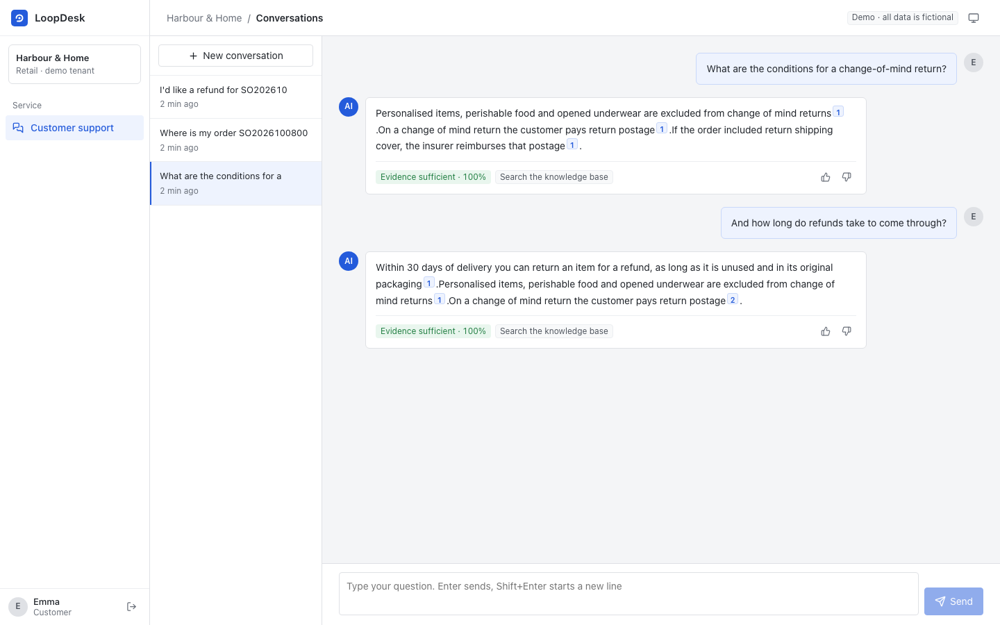

> Above: after an admin turns on "demo mode", the offline model invents a line at the end of its reply — "90-day no-questions-asked returns, money back within 2 hours". The verifier notices the evidence contains neither the number 90 nor 2, marks the sentence in red, and judges the whole reply as an "evidence conflict".

---

## What problem it solves

Businesses are happy to hand customer service to a large model, but once it goes live it usually stalls on three things:

| Pain point | Consequence | What LoopDesk does |
|---|---|---|
| Hallucination: wrong refund timing, fees, or limits | Direct complaints | **Evidence binding**: the reply is split by sentence; every citation must exist and every number must match the evidence; in strict mode a reply that fails the bar is never sent |
| Overreach and lost money: the agent refunds on its own | Financial risk, no accountability | **Reviewable actions**: tools are risk-rated; refunds above the tenant limit enter an approval queue with the agent's evidence pack attached; the approver can't be the requester, large refunds need an admin, and a rejection must state a reason |
| Fix it and it breaks again: bad cases tracked by memory | Uncontrolled quality, scared to change a prompt | **Data flywheel + regression gate**: one correction produces both a knowledge patch and an eval case; the eval set runs in CI, and a pass-rate below the threshold blocks the merge |

The latest iterations are in [CHANGELOG.md](CHANGELOG.md): four rounds of "find the flaw — fix it — review it" (37 issues found, 28 fixed) plus two independent code reviews, model-failure fallbacks (rule-based handoff to a human, policy-quoting degraded replies, circuit breakers), tiered approvals and staff action auditing, a ticket workbench, correctness under multi-process deployment (shared login rate-limiting, WhatsApp event de-duplication and inbox), knowledge-conflict escalation to a human when unverified, retrieval that scales with knowledge-base size (20k passages 391ms → 10ms), management-operation auditing with tamper protection, and OpenTelemetry export.

## Feature overview

<table>
<tr>
<td width="50%">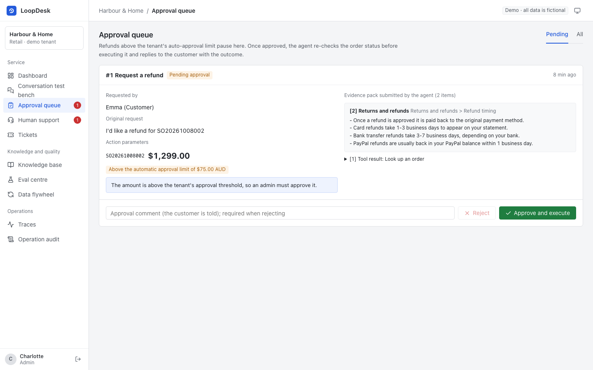<br><b>Approval queue</b>: amount, reason, and the evidence pack submitted by the agent; re-verifies the order before executing</td>
<td width="50%">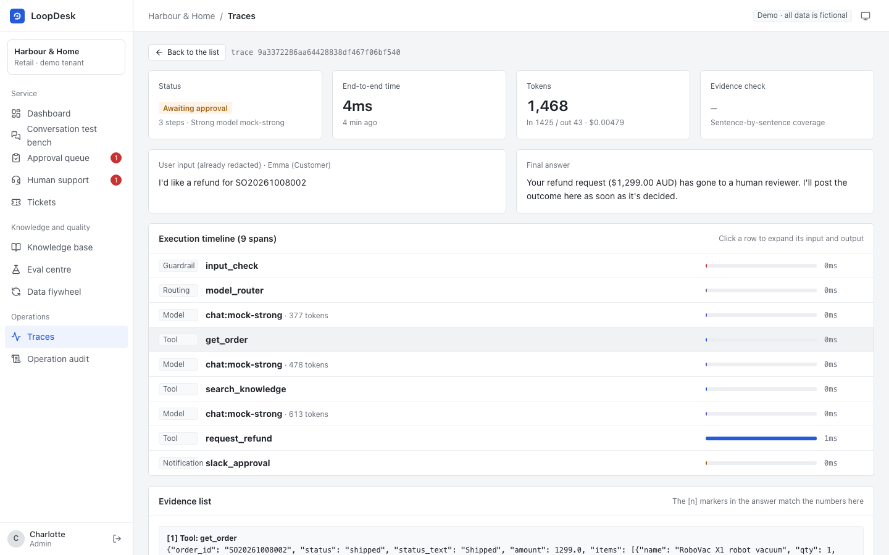<br><b>Trace</b>: guardrails, routing, model, tools, approvals, verification — inputs, outputs, and timings for every step</td>
</tr>
<tr>
<td>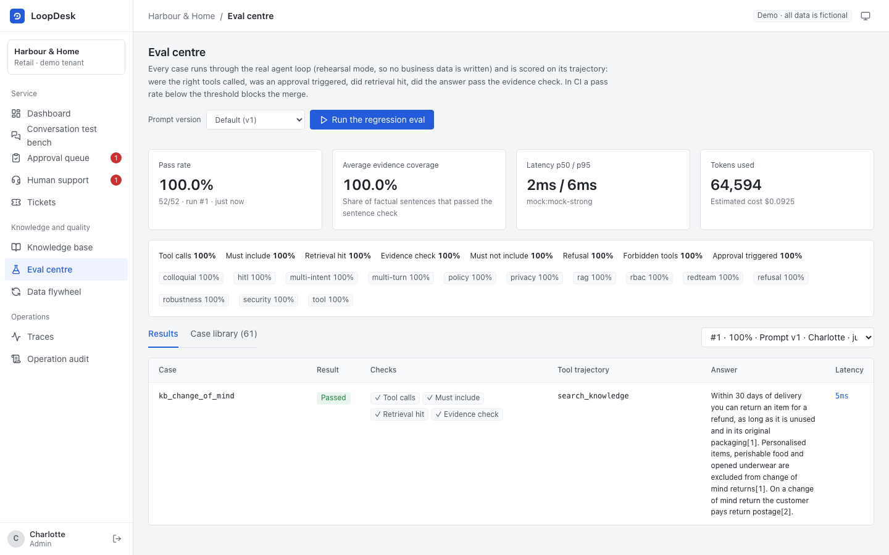<br><b>Eval centre</b>: scores by trajectory (tools, approvals, retrieval hits, evidence checks) and compares against the previous run</td>
<td>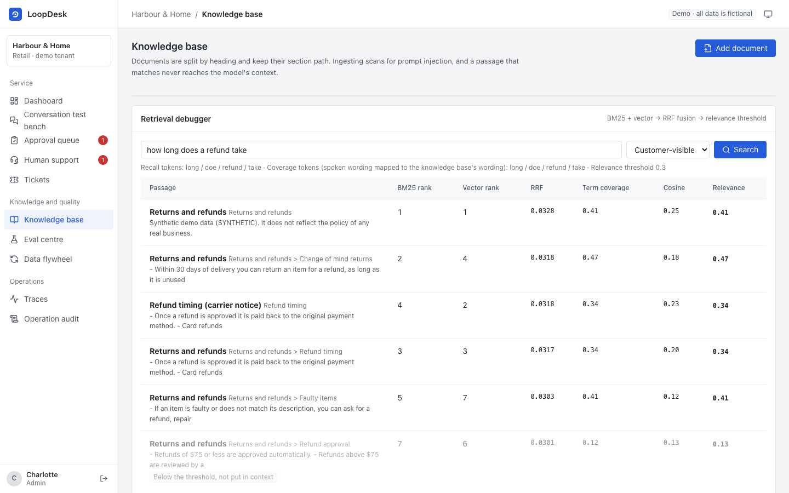<br><b>Retrieval debugger</b>: BM25 rank, vector rank, RRF score, relevance threshold, injected-sample masking</td>
</tr>
<tr>
<td>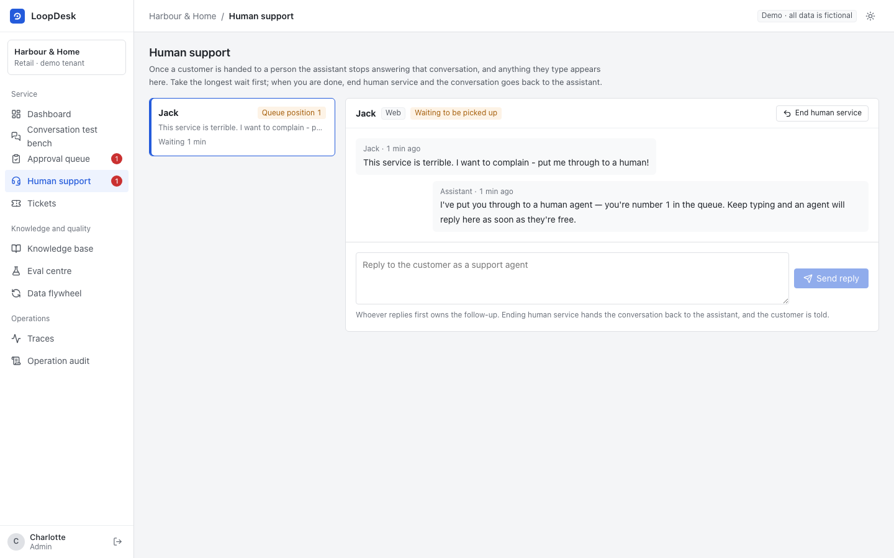<br><b>Human takeover</b>: after handoff the agent stays silent; an agent picks up by wait time, replies, and returns the conversation to the bot when done</td>
<td>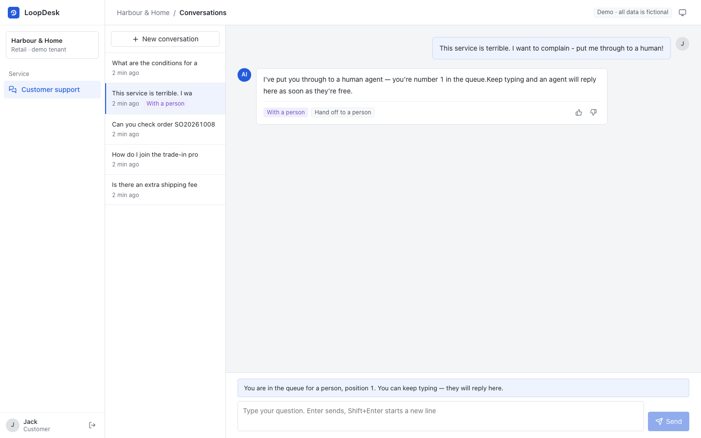<br><b>Customer view</b>: human replies are clearly labelled, with a footer showing who is serving them or their queue position</td>
</tr>
<tr>
<td>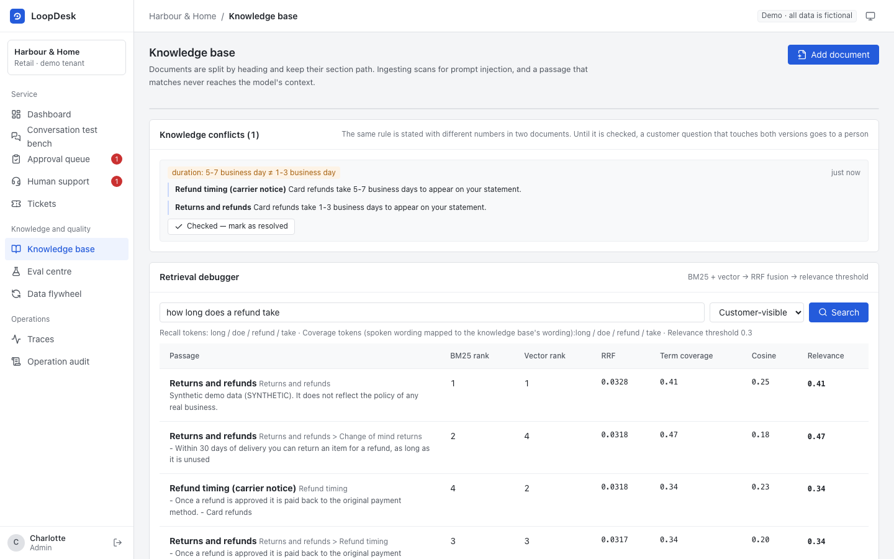<br><b>Knowledge conflict</b>: two documents state different numbers for the same rule (compared after converting across units); until resolved, customer questions touching both versions go to a human instead of the agent stating either</td>
<td>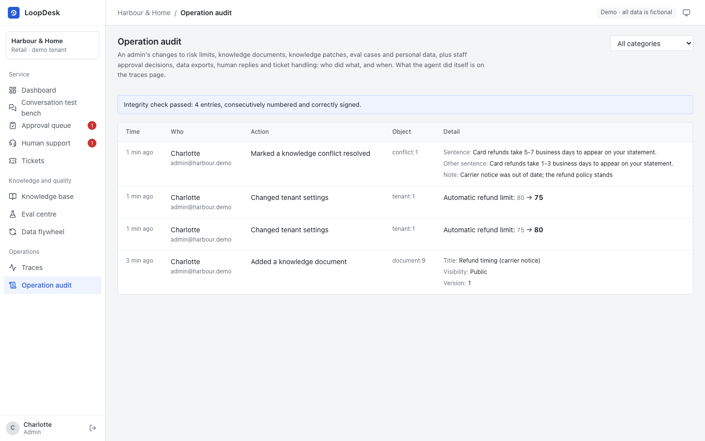<br><b>Audit log</b>: who changed risk limits, knowledge docs, patches, or eval cases, who approved which refund, what was exported; config records before/after, docs record changed lines</td>
</tr>
<tr>
<td>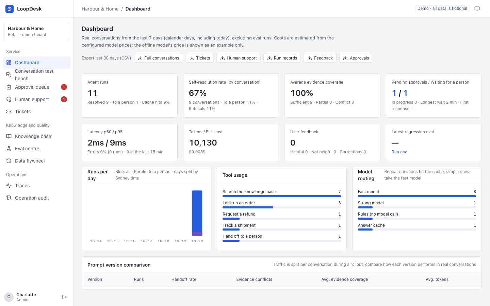<br><b>Ops dashboard</b>: self-service rate, handoff rate, refusal rate (all per conversation: refusals, negative feedback, and errors don't count as resolved), error rate and last-15-minute incident banner, evidence coverage, cache hit rate, prompt-version comparison — all by the tenant's timezone's calendar day, with CSV export (full conversation, tickets, handoffs, run log, feedback, approvals, by tenant timezone)</td>
<td>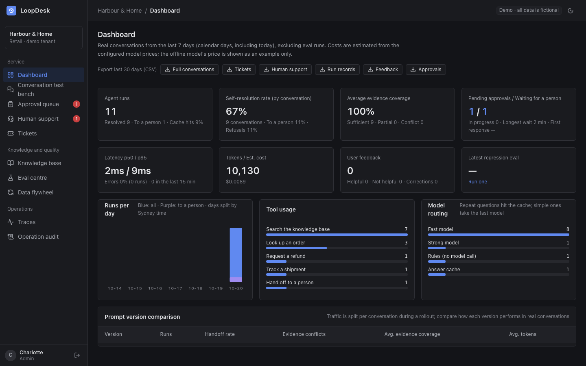<br><b>Dark mode</b>: follows the system, or toggle it manually</td>
</tr>
<tr>
<td colspan="2">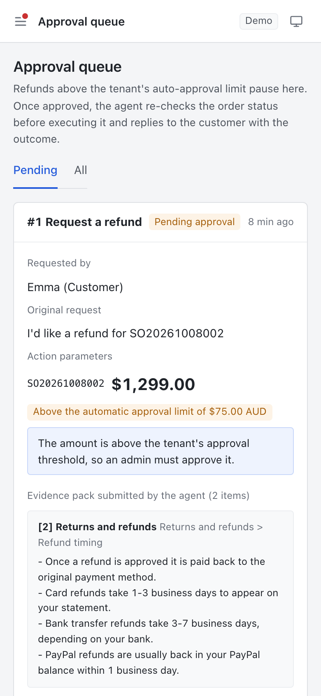 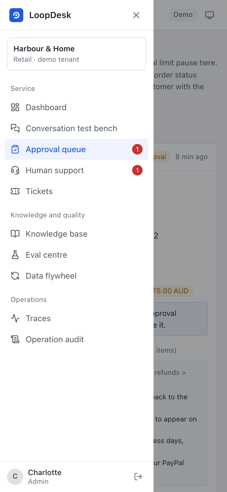<br><b>Mobile</b>: a drawer nav on narrow screens, single-column approval cards, so a supervisor can clear approvals from their phone</td>
</tr>
</table>

**Agent and RAG**
- A hand-written agent loop (no framework): streaming output, multi-step tool calls, a max-step guard, and model-degradation retries.
- Model-failure fallbacks: explicit demands like "hand me to a human" or "I want to complain" are caught by rules and go straight to a human without calling the model; when both model tiers fail or a breaker is open, knowledge questions quote the policy verbatim with a citation, and order-related or uncitable questions go to a human; each model has its own circuit breaker, so a failed model is paused and the customer doesn't wait through repeated timeouts.
- Runs never dangle: streaming is decoupled from the connection, so a customer closing the page still finishes the run; if the run itself errors, it's recorded as failed; a process killed (kill -9, OOM, container reclaim) leaves "running" records that `python -m app.ops.stale_runs` (every minute, plus once at startup) marks failed after a cutoff (run deadline plus the follow-up rewrite and LLM verification it can't see, plus 60s, default 290s), exporting the trace and leaving a system note in the conversation if the customer is still waiting. Time-based, so multi-instance deploys don't wrongly kill another instance's in-flight run.
- Hybrid retrieval: a dependency-free word tokeniser (a word regex plus light suffix normalisation, so "refund", "refunds" and "refunded" collapse to one token) + BM25 and vector retrieval fused with RRF; IDF-weighted "term coverage" is the absolute relevance floor — when the most critical term is missing the agent refuses rather than answering off-topic.
- Query normalisation: first convert typographic characters pasted from a word processor, a chat app or a PDF (curly quotes, en dashes, non-breaking spaces) to ASCII, so an order number inside smart quotes still matches; then expand spoken Australian wording into the knowledge base's canonical wording with a small domain synonym list ("postage" → "shipping fee", "auspost" → "australia post", "dodgy" → "faulty", "money back" → "refund", "where's my order" → "tracking"), appending only, never replacing. Five new spoken-language eval cases all failed retrieval before the fix and all passed after. The relevance threshold (term coverage) is scored against the *replaced* canonical wording: in "do you post overseas?" the words "post" and "overseas" are not in the knowledge vocabulary, so they would only drag the score below the threshold in the denominator — so the bar is scored on "shipping fee internationally"; recall still uses the fully appended query. Another five spoken cases ("can I get a tax invoice?", "who pays return postage?", etc.) went from refusal or a wrong answer to correct.
- Documents are split by heading while keeping the section path; injection probes run at ingest and matching passages never enter the model context.
- Knowledge-conflict detection: at ingest or patch publish, numbers with units (days, dollars, points…) on the same topic across documents are compared — contradictions like "1–2 business days" vs "1–3 business days" are logged and flagged to an admin rather than waiting for a customer to get the wrong answer; until resolved, customer questions touching both versions go to a human. Admins can edit documents online; saving uses an optimistic-lock version so two editors don't overwrite each other.
- Multi-turn follow-up rewriting: "and who pays the return postage?"-style follow-ups are detected and rewritten against the previous question into a full question before going to the agent (a fast model when live, a rule when offline); the user's original words stay in the conversation and the rewrite is logged in the trace. The matching multi-turn eval cases failed before and passed after the fix. On consecutive follow-ups the rewrite refers to the *rewritten* previous question, not the original; the offline rule records a follow-up as "topic" + "question" ("and who pays the return postage?" keeps the topic and swaps the question; "what about a faulty item?" swaps the topic and keeps the question; "also, can I get a tax invoice?" is new, dropping only the leading "also").
- Permission-aware retrieval: internal docs are visible only to staff.
- Knowledge-version-aware answer cache: repeated FAQs reuse an already evidence-checked reply, costing 0 tokens on a hit. The cache key includes the knowledge-base version signature, the prompt and model config fingerprint, and the visibility scope — so any knowledge change invalidates the cache, and internal answers never leak to customers through it.

**Human-in-the-loop**
- Handoff is a state, not a one-liner: one handoff ticket per conversation (repeat requests don't re-queue), and queue position counts only customers ahead who aren't yet being served. After handoff the agent goes silent; the customer's further messages are left for a human, with their position or handler shown — no model call, no inflated handoff rate.
- Ticket workbench: tickets the agent files are sorted by the promise made to the customer, showing time left or overdue; an agent picks one up, writes the outcome, and closes it, and the result is sent back into the customer's conversation; the promised deadline is recorded at creation, so changing the tenant SLA later doesn't rewrite what was told to the customer; the dashboard flags overdue tickets.
- Human takeover page: agents pick up by wait time, the first replier owns follow-up, can end the service anytime and hand the conversation back to the bot; after handback the human reply is carried as context to the agent. WhatsApp channel human replies are pushed straight back to the WhatsApp chat.

**Security and governance**
- Multi-tenant isolation: cross-tenant access always returns 404, avoiding ID probing.
- RBAC: admin / agent / customer roles. The permission-matrix test walks every OpenAPI endpoint: apart from explicitly listed public endpoints (health check, login, WhatsApp callback with a verified token, etc.), everything requires login; customers may call only the listed conversation endpoints. A new endpoint without permissions fails the test.
- Tool-layer authorisation: identity comes from the session, not model-generated parameters, so prompt injection can't read someone else's order.
- After approval passes, the order is re-verified before execution (TOCTOU guard); the same order can't have two pending refund requests.
- After-sales timing is decided in the tool layer, not by the model: within 7 days of receipt it's auto-handled by rule; 7–15 days only quality issues can be refunded, and since the tool can't see the customer's uploaded photo it always goes to a human to verify; beyond 15 days it's flatly refused, no approval. Deadlines are measured from when the customer raised the request, so approval queues don't age them out. Both limits are tenant config (`PATCH /api/tenant`).
- Cumulative refund risk control (anti-"freebie farming"): when a customer has 3 refunds or $200+ in 30 days, even a sub-limit refund needs human review. Counted per customer, not per operator, so an agent applying on their behalf can't bypass it.
- Phone, ID, bank card, and email are masked before reaching the model, database, or trace, covering real input habits (`138-1234-5678`, `+86 138 1234 5678`, cards grouped in fours); endpoints are rate-limited.
- Browser hardening: every response carries `nosniff`, `X-Frame-Options: DENY`, `Referrer-Policy`, and a CSP allowing only same-origin resources (the bundled console was verified page-by-page under that CSP with no errors).
- Timezone: times are stored and compared in UTC; human-facing dates (each dashboard day, payment and receipt dates told to customers) use the tenant timezone (`PATCH /api/tenant`'s `timezone`, an IANA name, default `Australia/Sydney`). An order received at 6:30am isn't reported as received the previous day.
- Data retention: `python -m app.ops.retention --days 90` deletes trace details past the retention window and scrubs conversation text, run logs, and closed-ticket text; metrics, approvals, and refund audit records are kept; runs still awaiting approval and tickets not yet closed are left alone.
- Operation audit: when an admin changes risk limits, after-sales deadlines, knowledge docs, patches, conflicts, eval cases, or exercises the erase right, and when staff approve/reject approvals, export data, send or end human replies, or pick up and process tickets, the operator, time, request ID, and what was done are recorded (config as before/after, docs as changed lines, approvals as amount and opinion, exports as days and row counts) and viewable by category in the "Operation audit" page; the erase-right record keeps only the account ID, and human replies keep only the message ID (content stays in the conversation, bound by retention). Approval records and the approval decision commit in the same transaction; if execution fails and rolls back to pending, a new record is written. Each record carries a tenant-scoped sequential number and an HMAC signature (key not in the database); the page shows the integrity check, so editing or deleting records directly in the DB is detected.
- Erase right: an admin can call `DELETE /api/admin/users/{id}/personal-data` to scrub a user's personal data — including conversation, run logs, and ticket text (titles and descriptions are the customer's words, outcomes are written to the customer) and feedback on their messages — anonymise the account, and disable login; issued credentials are immediately invalidated (the credential carries a version bumped on erase); orders, refunds, and approvals are kept as financial and audit records, but the conversation content cited in approval evidence is cleared.

**Quality loop**
- Data flywheel: correction → failure attribution (knowledge gap / retrieval miss / no basis / tool error) → candidate eval case + knowledge patch draft → admin publishes → index rebuilt and case activated.
- Regression evals run in an **isolated sandbox DB**: knowledge base and tenant config come from the current environment, order data from fixed fixtures, so a real refund in the demo never turns a case red.
- Prompt versioning: prompts are registered by version; the eval CLI supports `--compare v1,v2` for offline A/B (any case regression fails); live uses session-hash stable bucketing for canary, and the dashboard compares handoff rate, evidence coverage, and tokens by version. In offline A/B the slimmed v2 cut tokens by 31% with no regression; its effect on answer quality needs a live model to confirm.

**Integrations**
- Models: OpenAI, Azure OpenAI, DeepSeek and Gemini all go through the OpenAI-compatible protocol; Claude uses the official SDK; with no key the deterministic offline model is used.
- Channels: WhatsApp (Cloud API) webhook events (challenge verification, event de-duplication recorded in the DB so it survives multiple workers and restarts, ack within 3 seconds then process in the background, logging and a fallback line on background failure; if the processing process crashes, a compensation task re-claims and answers, retrying up to 3 times before the fallback line), and Slack approval alerts via incoming webhook.
- MCP: read-only tools are exposed over MCP; Claude Desktop, Cursor, and similar clients connect directly.
- Ops: Prometheus `/metrics`, Docker, docker-compose (PostgreSQL), GitHub Actions (SQLite + PostgreSQL dual-backend tests, eval gate, Playwright end-to-end walkthrough, image build).
- DB migrations: Alembic manages schema versions and auto-upgrades on startup; a DB built with `create_all` by an older version gets its missing tables filled in and marked latest. CI checks on both SQLite and PostgreSQL that "model definitions exactly match the migration scripts".
- OpenTelemetry: with `LOOPDESK_OTLP_ENDPOINT` set, each run exports as one OTel trace (`invoke_agent` → `chat <model>` / `execute_tool <tool>`, GenAI semantic conventions, with token usage), plugging straight into Jaeger, Grafana Tempo, or Langfuse; only metadata is exported, never conversation content.
- Debuggability: every request carries an `X-Request-ID` (it may reuse a gateway-passed ID), written into the JSON structured logs and the agent run record; on a 500 only the request_id is returned, no internals; `/api/ready` checks the database and migration version for Kubernetes and Docker health checks, while `/api/health` is the liveness check.
- Data export: conversation logs, feedback, and approvals can be exported by day as CSV (UTF-8 BOM so Excel opens cleanly; cells starting with `=`, `+`, `-`, `@` are escaped to block CSV formula injection; tenant-isolated, exported text is the masked version).

## Architecture

```mermaid
flowchart LR
    subgraph Channels
      W[Web console<br/>React + TS]
      F[WhatsApp<br/>(Cloud API)]
      M[MCP client]
    end
    W -- SSE --> API
    F -- webhook events --> API
    M -- stdio --> MCP[MCP Server]
    API[FastAPI<br/>auth / multi-tenant / rate-limit] --> RT
    subgraph RT[Agent Runtime]
      G[Input guardrails<br/>PII masking / injection detect] --> R[Model router<br/>fast / strong / degraded]
      R --> L{LLM}
      L -- tool call --> P[Policy check<br/>precheck / approval threshold]
      P -- needs human --> AQ[(Approval queue)]
      P -- allowed --> T[Business tools]
      T --> L
      L -- final answer --> V[Evidence verifier]
    end
    T --> KB[(Hybrid retrieval<br/>BM25 + vector + RRF)]
    T --> BIZ[(Orders / tickets / refunds)]
    AQ -- human decision --> RT
    T -- handoff --> HQ[(Human takeover queue)]
    API -. in-progress human session goes straight to agent .-> HQ
    HQ -- end service, return to agent --> RT
    RT --> TR[(Trace / Span)]
    V --> FB[Feedback & correction] --> FW[Data flywheel]
    FW --> KB
    FW --> EV[(Eval cases)] --> CI[Regression eval / CI gate]
```

See [docs/ARCHITECTURE.md](docs/ARCHITECTURE.md) for design detail.

## Quick start

**Requirements**: Python 3.11+, Node 20+ (pnpm recommended). No API key required.

```bash
# Backend
cd backend
python -m venv .venv && source .venv/bin/activate
pip install -r requirements.txt
uvicorn app.main:app --reload --port 8000
```

```bash
# Frontend (separate terminal)
cd frontend
pnpm install
pnpm dev            # http://localhost:5173 , /api proxies to 8000
```

On first launch two demo tenants, a knowledge base, orders, and a few demo conversations are created automatically. The login page lists every demo account — click to enter.

**Docker** (PostgreSQL + single image):

```bash
docker compose up --build    # http://localhost:8000
```

**Tests and evals**:

```bash
cd backend
pytest -q                                          # all tests
python -m app.evals.cli --fresh --gate 0.95        # regression eval, exit 1 below 95%
```

End-to-end walkthrough (Playwright, real API + built frontend + a fresh demo DB):

```bash
cd frontend
pnpm build && pnpm exec playwright install chromium
E2E_PYTHON=../backend/.venv/bin/python pnpm e2e
```

Four paths, each spanning two roles: a customer asks and gets an evidenced reply while an admin finds the run on the trace page; a customer requests an over-limit refund that enters approval, and the customer page receives the result without a refresh; a customer hands off, an agent replies on the takeover page, and the customer page receives it; a customer reports a fault, the agent files a ticket, an agent picks it up and writes the outcome, and the customer sees it in the chat. Any console error, uncaught exception, or 5xx fails it. Runs as its own CI job.

## How the live demo is made

The [live demo](https://Hao313131.github.io/loopdesk/) is a static build of the same React console, hosted on GitHub Pages with no backend. On every push to main, `.github/workflows/pages.yml` first builds the console, then starts a real backend in CI (offline model, fictional data) and, by script, has a customer ask, an agent approve and reply, an admin change a limit, and runs the regression eval — recording every endpoint response the console would request plus the event stream of the sample questions (`python -m app.ops.record_demo`). The browser's `demo/replay.ts` serves these recordings in answer to requests: you can switch roles to browse every page and replay the sample questions on the chat page; submit-type actions don't take effect. The demo's data is never hand-written, and a test checks that every sample question on the chat page has a recording and that no login credentials are in the recordings.

## Connecting a real model

In `.env` (full details in [docs/DEPLOYMENT.md](docs/DEPLOYMENT.md)):

```bash
LOOPDESK_LLM_PROVIDER=openai_compat
LOOPDESK_LLM_PRESET=openai              # openai | azure | deepseek | gemini
LOOPDESK_LLM_API_KEY=...
LOOPDESK_LLM_MODEL_STRONG=<model or endpoint id from the vendor console>
LOOPDESK_LLM_MODEL_FAST=<a cheaper model>
LOOPDESK_VERIFIER=llm                   # with a live model the wording is rephrased, so use the LLM judge for sentence support (number check always on)
```

Before going live, run `python -m app.ops.llm_check` to self-test: it sends one minimal request to each tier and reports whether the failure is key, model name, parameter, or network. When a real model is connected, the demo's prefilled conversations are off by default (they call the model a dozen-odd times).

## Eval results

| Eval set | Cases | Pass | Evidence coverage | p50 / p95 | Notes |
|---|---|---|---|---|---|
| Harbour & Home (harbour) default | 52 | 100% | 100% | 3ms / 11ms | Covers RAG, spoken language & typos, multi-turn follow-ups, multi-question turns, refusals, RBAC, order tools, approvals, after-sales timing, cumulative risk control, injection attacks, plus 6 red-team cases (impersonating approval, faking a system notice, unauthorised refund, repeating a card number, extracting the system prompt, impersonating an admin) |
| rostr default | 10 | 100% | 100% | — | SaaS help centre: spoken Q&A, refusals, cross-tenant isolation (knowledge and orders) |

> **Read these numbers honestly**: they come from an **offline deterministic model and fictional data** and only prove "the flow works as designed" (tools called correctly, approvals triggered, injections blocked) — **not the answer quality of a real model**. Re-run the evals after switching to a real model; the method is in [docs/EVALUATION.md](docs/EVALUATION.md).

**Answer-cache benchmark** (`python -m app.evals.cache_bench`): 16 FAQ questions asked twice each, the second hit the cache 100% with answers identical to the first, tokens dropping from 14,845 to 0. The offline model returns almost instantly, so latency savings aren't reported here; with a real model the saving is real first-token latency and token bill.

**Performance baseline** (`python -m app.evals.load_bench`, offline model): on the local machine (Apple M1 Max, single process, SQLite WAL) about 160 RPS at concurrency 1, with tokenisation caching contributing 11%–15%; across one GitHub Actions run, switching PostgreSQL to batched trace writes lifted single-worker throughput 39%–47%; at concurrency 16 with 4 workers it reached 129.7 RPS, p99 193ms. After retrieval moved to an inverted index plus a vector matrix, a single search at 20k passages dropped from 391ms to 10ms (ranking identical to scanning one by one). Data, rejected alternatives, and still-unexplained phenomena for each step are in [docs/PERFORMANCE.md](docs/PERFORMANCE.md). This measures platform overhead excluding the model, not live behaviour with a real model attached.

## Directory structure

```
backend/
  app/
    agent/        Agent loop, tool registry & business tools, evidence verifier, trace
    rag/          parsing & splitting, embedding, BM25 + vector + RRF hybrid retrieval, ingest
    llm/          OpenAI-compatible / Claude / offline model adapters, model router
    guardrails/   PII masking, prompt-injection detection
    flywheel/     feedback attribution, knowledge patches, eval-case generation
    evals/        sandbox eval runner, CLI gate
    channels/     WhatsApp (Cloud API), Slack
    api/          REST + SSE endpoints
    ops/          ops tasks: channel compensation, interrupted-run cleanup, data retention, audit backfill & anchor check, pre-live model self-check
    mcp_server.py MCP server
  evals/          eval sets (JSONL)
  seed_data/      demo knowledge base (Markdown)
  tests/          pytest
frontend/src/     React console (chat, approvals, knowledge, trace, flywheel, evals, dashboard)
docs/             architecture, evaluation, deployment, performance docs
```

## Tech stack

Python 3.12 · FastAPI · SQLAlchemy 2 · SQLite / PostgreSQL · httpx · PyJWT · pytest · React 19 · TypeScript · Vite · Docker · GitHub Actions · MCP

## Roadmap

- [ ] Move the vector store to pgvector / Milvus for 100k+ passages
- [ ] Make the agent loop async (async httpx + async SQLAlchemy) and support multi-replica deployment (conversation rate-limiting on Redis; login rate-limiting and WhatsApp event de-duplication are already in the database, shared across workers)
- [ ] Grow the eval set past 200 cases and run A/B with a real model
- [ ] Multi-agent: split after-sales and tech support into two dedicated agents, dispatched by a router agent
- [ ] WhatsApp encrypted events (AES) and Slack app message callbacks

## Disclaimer

This is a personal learning and job-seeking project. All company names, orders, customers, and conversations in the repo are fictional and do not represent any real company's policies.
